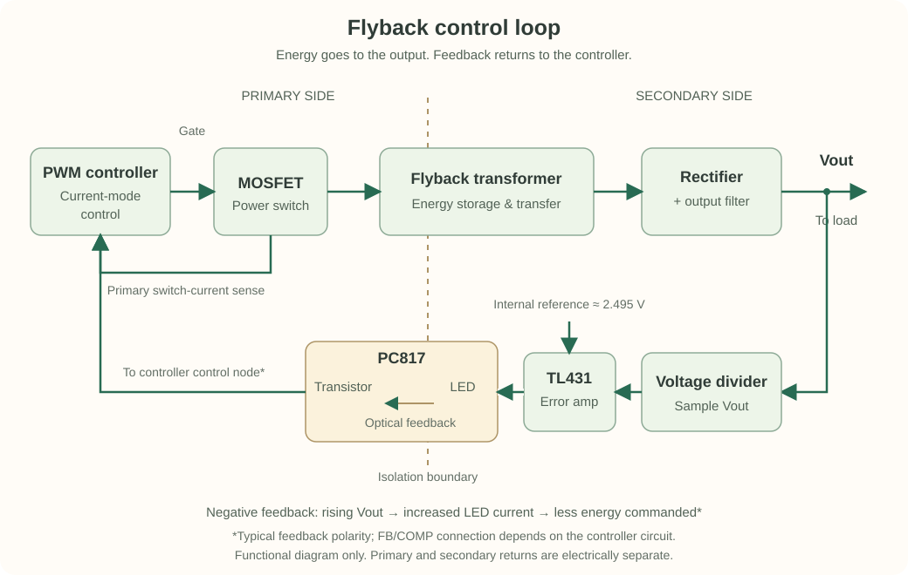

How does the output of an isolated flyback converter tell the primary-side controller to change its switching behavior?

In [my flyback simulation journey](), I wrote about spending three weeks on a circuit before giving up. The TL431 and PC817 feedback network is one part I want to understand better before handling the whole schematic again.

So I’m breaking it down into smaller pieces. These are my notes as I work out what each part is doing and how the feedback gets back to the controller.

## The signal path

*The dashed line marks the isolation boundary. This is a functional diagram, not a wiring schematic. The outer loop regulates output voltage; the local current-sense path supports current-mode control.*

The transformer transfers energy across the isolation barrier. The feedback circuit sends information back across it.

For a common secondary-side feedback arrangement, the path is:

**Output voltage → resistor divider → TL431 → PC817 → primary-side controller**

The TL431 responds to the sampled output voltage. The PC817 carries the feedback optically, keeping the primary and secondary grounds electrically separate. This is the arrangement described in [TI's guide to optocoupler biasing](https://www.ti.com/document-viewer/lit/html/SSZTCW5/GUID-176CD139-5619-4F61-9C64-F032884185A1).

## TL431: sensing the output error

The TL431 was a little confusing to me at first. It has three pins—reference (REF), anode, and cathode—but what is it actually doing in the feedback loop?

The idea that helped me is this: it watches the voltage at REF and adjusts how much current it sinks from cathode to anode. Its internal reference is about 2.495 V, so the surrounding circuit can use it to keep the REF pin close to that value.

A resistor divider lets us turn that reference into a higher voltage target. With R1 from the output to REF and R2 from REF to the secondary return:

$$
V_{out} \approx V_{ref}\left(1 + \frac{R_{1}}{R_{2}}\right)
$$

For a simple starting point, I tried equal resistors: R1 = R2 = 10 kΩ. That puts the target near twice the reference voltage, or roughly 5 V.

In my LTspice circuit, a 12 V source feeds the node through a 10 kΩ resistor, and the TL431 sits across the divider. The output trace sits around 5.002 V in this model. Seeing that helped the equation feel a bit less abstract: the divider samples the voltage, and the TL431 adjusts its current to hold the node near the target.

There’s one detail I still need to keep an eye on. The supply resistor only provides about (12 − 5) / 10 kΩ = 0.7 mA, and the divider uses some of that too. A flat trace in this simulation doesn’t tell me whether a real TL431 has enough cathode current to regulate reliably. I’ll need to check the minimum current for the exact part before choosing resistor values for hardware.

For now, my takeaway is that the TL431 is continuously adjusting current. In the flyback feedback circuit, that changing current helps drive the optocoupler LED. The divider chooses the voltage target; bias current, voltage headroom, and compensation still need attention. The [TI TL431 datasheet](https://www.ti.com/lit/ds/symlink/tl431.pdf) is what I’m using to check those details.

## PC817: carrying the signal across isolation

The PC817 contains an infrared LED and a phototransistor. LED current produces a response on the transistor side without a conductive signal connection between the two sides.

One useful parameter is current transfer ratio, or CTR:

$$
CTR = \frac{I_C}{I_F} \times 100\%
$$

Here, I_F is LED current and I_C is collector current under the specified test conditions. CTR varies with operating conditions and device grade; it is not a universal, fixed gain. The transistor's operating region also matters. A simulation using one nominal value cannot represent every device or bias point. Check the [Sharp PC817 series datasheet](https://global.sharp/products/device/lineup/data/pdf/datasheet/PC817XxNSZ1B_e.pdf) against the exact part you use.

## When the output rises

In a common connection, an increase in output voltage raises the divider voltage. The TL431 draws more cathode current, increasing optocoupler LED current. The primary-side transistor then changes the controller's control signal so that less energy is delivered to the output.

That is negative feedback: the response opposes the original rise. The exact connection to FB or COMP depends on the controller circuit. I need to trace my schematic before assuming which pin moves in which direction.

## How I plan to study it in LTspice

I want to start with the feedback network on its own, using a controllable DC source in place of the converter output.

1. Sweep that source around the intended output voltage.
2. Plot the TL431 reference voltage, cathode current, optocoupler LED current, and transistor-side response.
3. Check whether the response would command less power when the output rises.
4. Check bias and headroom across the sweep, not just at the setpoint.

The little TL431 test above is my first step. Next, I want to add the PC817 and follow the signal through both parts. That should help me check the current levels and feedback direction. Checking the stability of the whole flyback will come later, once I can look at the complete loop and how it responds over time.

TI also discusses why the TL431 may need a separate bias path when optocoupler current is low in its [article on flyback standby-power losses](https://www.ti.com/document-viewer/lit/html/SSZTCM8/GUID-257F37D5-BC84-4004-A301-2383ED786190).

## The question I want to answer next

Before changing compensation components, I want to answer a simpler question: **are both devices correctly biased, and does the feedback act in the right direction?**

That gives me a concrete starting point for returning to the flyback simulation—one signal path at a time.
