Altium Designer is a powerful tool for drawing schematics and designing PCBs. I’m learning it through a practical task: turning my manager’s circuit design into a schematic.

## My first assignment

The first circuit I was asked to draw used a **precision reinforced isolated amplifier**. My job was to capture the design in Altium and check it against my manager’s schematic.

## Why we needed isolation

The earlier sensing circuit used an op-amp with a shared ground between the input and output. My manager identified the need to isolate the high-voltage sensing side from the controller circuit, which operates mainly at 3.3 V and 5 V.

We switched to an isolated amplifier to separate those two sides while still passing the measurement signal to the controller.

## A helpful feature: integrated isolated power

The part we selected also includes isolated power transfer. It powers the high-side sensing circuitry from the low-voltage supply, so we don’t need a separate high-side supply.

That feature depends on the specific IC. When choosing a part, check its datasheet for the supply requirements and whether isolated power is included.

## Bringing the design into Altium

With the circuit design provided by my manager, I could focus on drawing and checking the schematic. I’ll break down the steps here, starting with the component library.

### 1. Find the symbol and footprint

I mostly use **Ultra Librarian** to find the IC’s schematic symbol and PCB footprint, then add them to the library.

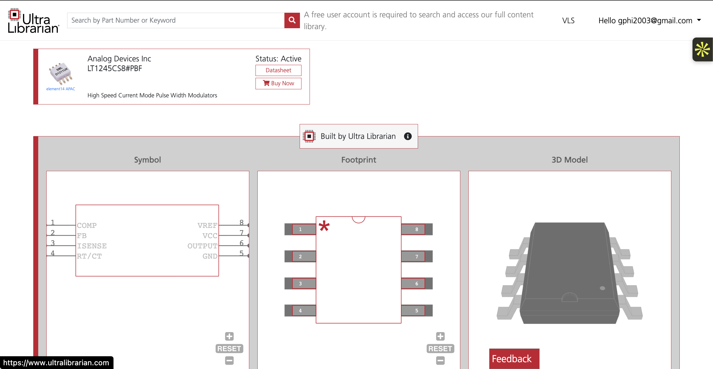

Next, select **Altium Designer** as the CAD platform and download the ZIP file.

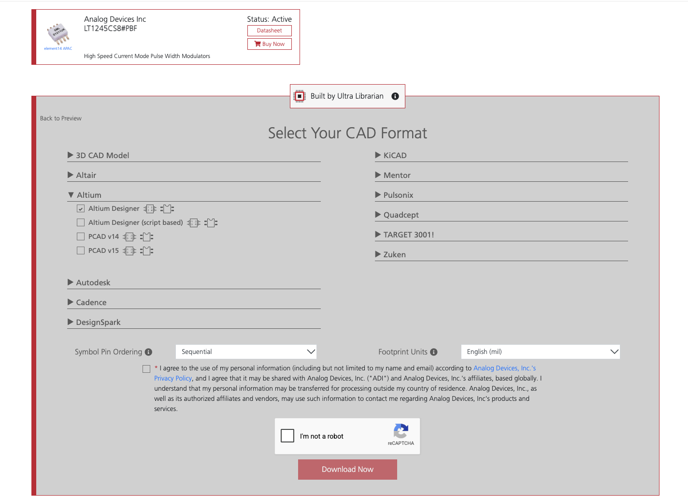

### 2. Add the symbol to your library

Open the downloaded `.LibPkg` file in Altium Designer, then open its schematic library (`.SchLib`). Copy the component into the `.SchLib` you want to use for your project.

Here’s the imported **LT1245** symbol before any changes:

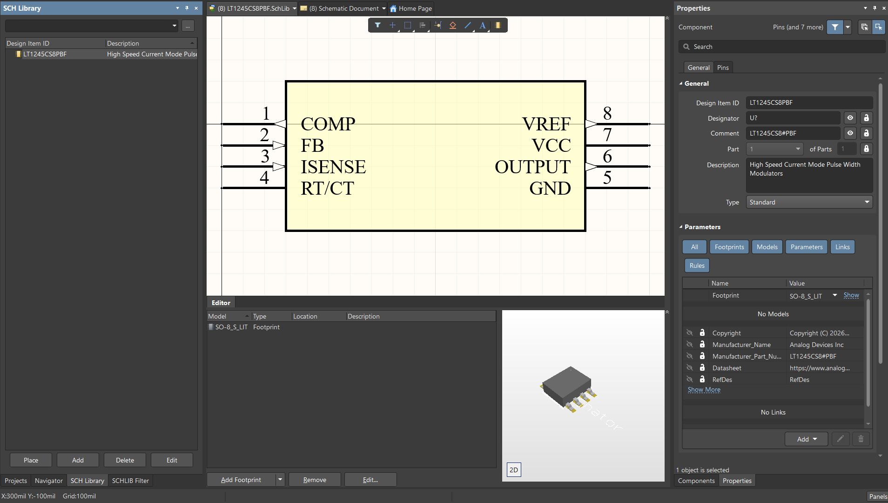

### 3. Arrange the symbol to make the schematic easier to read

One useful trick is to move the pins around the symbol so the connections are easier to follow. For my layout, I grouped them like this:

- **Top:** VCC
- **Bottom:** GND and RT/CT
- **Right:** OUTPUT and ISENSE
- **Left:** COMP, FB, and VREF

This changes where the pins appear on the drawing. **Keep each pin’s number and electrical identity unchanged**, so it still connects to the correct footprint pad.

I like keeping pin numbers outside the symbol body and pin names inside. It makes the symbol easier to scan while drawing the circuit.

Here’s the edited version:

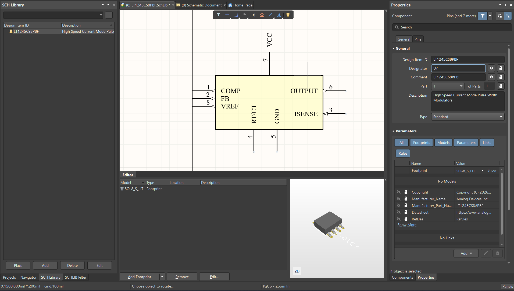

You can also edit the component’s description, designator, and comment in the **Properties** panel. Before moving on, compare the pin names and numbers with the datasheet to make sure nothing changed accidentally.

### 4. Manufacturer Part Search and company libraries

One thing that confused me at first was the difference between Altium’s online component search and a company’s own library.

**Manufacturer Part Search** helps you find manufacturer and supplier information, along with symbols and footprints where available. An **Altium 365 Workspace** is a separate environment where a team can manage its own components and projects. Finding a part online doesn’t automatically make it part of the company’s approved library.

For me, Manufacturer Part Search has been a convenient alternative to Ultra Librarian. To bring an available model into a local library:

1. Find the part in **Manufacturer Part Search** and check that it has the models you need.
2. Right-click it and choose **Download as File Library**.
3. Extract the ZIP file and open the source libraries in Altium.
4. Copy the component into your destination library, then edit its name or properties as needed.

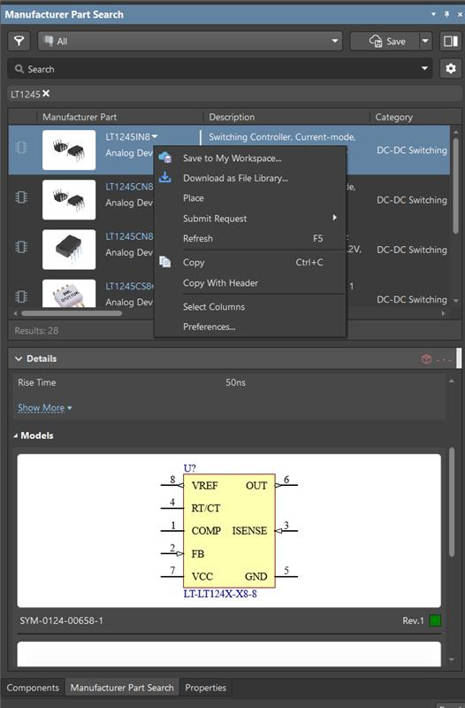

This saves me a few steps, but I still check the downloaded models against the datasheet. Altium explains the process in its [guide to copying components into libraries](https://www.altium.com/documentation/knowledge-base/altium-designer/copy-and-paste-a-component-from-to-a-library).

### 5. Give related circuits enough space

Sometimes I need more room to keep related circuits together. Increasing the sheet size helps avoid squeezing everything into a crowded drawing.

Click a blank area of the schematic so nothing is selected, then open the **Properties** panel. You can also double-click the sheet border to open the document options.

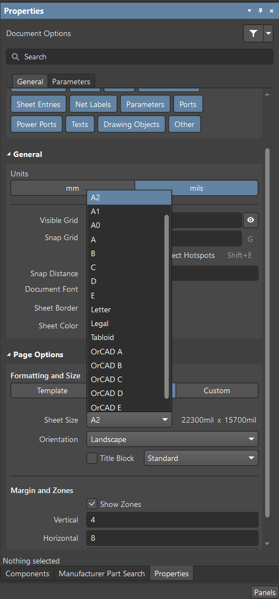

Under **Page Options**, choose a suitable standard sheet size. If a template controls the sheet, check its settings too. See Altium’s [schematic document setup guide](https://www.altium.com/documentation/altium-designer/schematic/setting-up-document) for the available options.

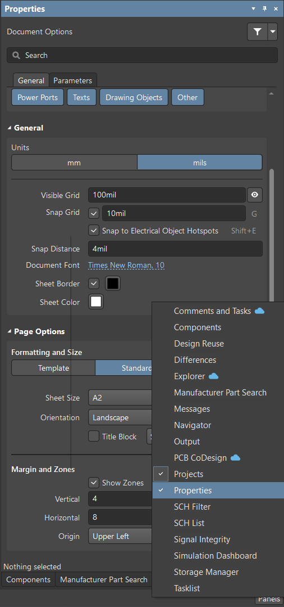

### 6. Use the snap grid to line things up

When I started wiring, some pins and connectors didn’t line up neatly. Adjusting the **snap grid** helped me position them more precisely.

The snap grid sets the placement increments for the cursor. Press **G** to cycle forward through the predefined sizes, or **Shift + G** to cycle backward. You can also enter a value in the document properties.

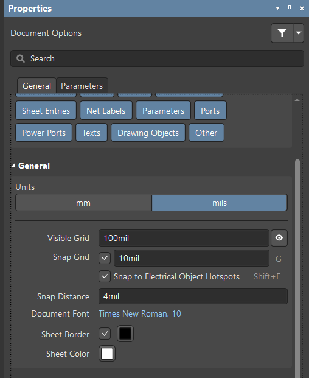

A **10 mil** grid helped with my alignment work. That was a useful setting for this drawing, rather than a minimum value for Altium. I still want pins and wire endpoints to share a consistent grid so they connect cleanly.

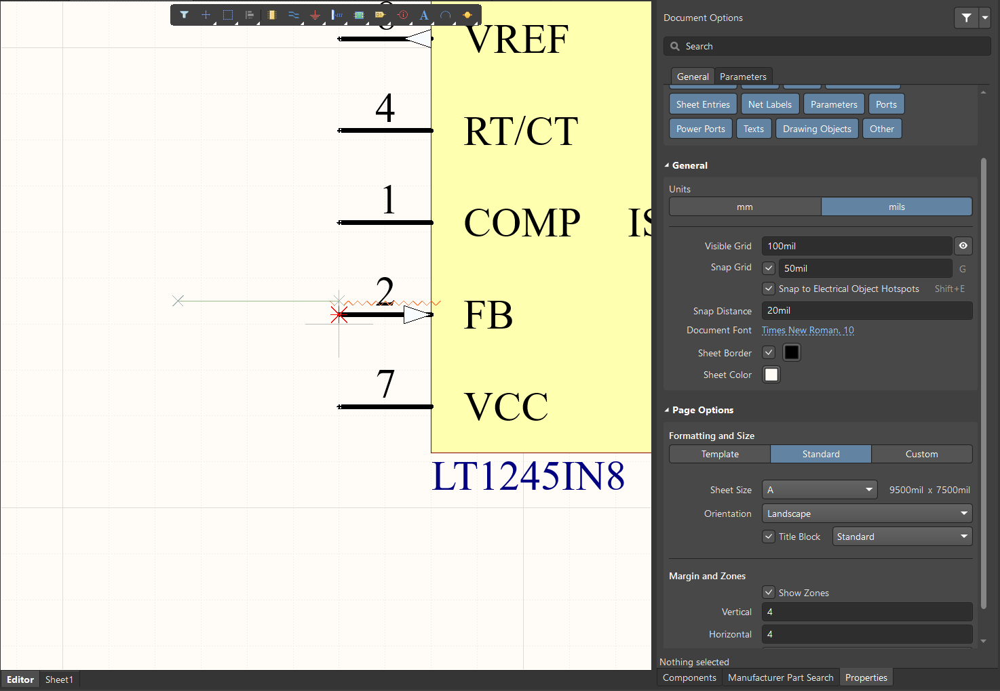

### 7. Use ports with the project’s sheet structure in mind

Another task was replacing net labels with **ports** to make signals easier to follow as the project grew across multiple sheets.

The important detail is the project’s **Net Identifier Scope**:

- **Flat:** matching ports connect across sheets; net labels stay local to each sheet.
- **Hierarchical:** child-sheet ports connect through matching sheet entries on the parent sheet.
- **Global:** matching net labels can also connect across sheets.

So replacing a label with a port is only part of the job. I also need to check the project settings and sheet structure. Altium’s [connectivity guide](https://www.altium.com/documentation/altium-designer/schematic/creating-circuit-connectivity) explains these differences.

To add one, use **Place → Port** and choose the appropriate I/O type:

- **Input:** a signal entering the sheet.
- **Output:** a signal leaving the sheet.
- **Bidirectional:** a signal that travels both ways.
- **Unspecified:** no direction specified.

These types describe the intended signal direction and support electrical checks. Port cross-references, when configured, also help show where a signal appears on other sheets.

### 8. Check connections that only look connected

Two wires can look like they touch while still having a small gap. This is an easy detail to miss when zoomed out.

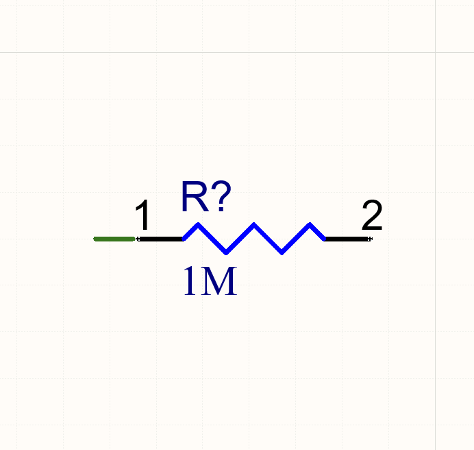

A useful check is **Alt + Click on a wire or another net object**. Altium highlights objects belonging to that net, which helps me follow the connection and spot anything unexpected. If a wire isn’t part of the highlighted net, I zoom in and check its endpoint and grid alignment.

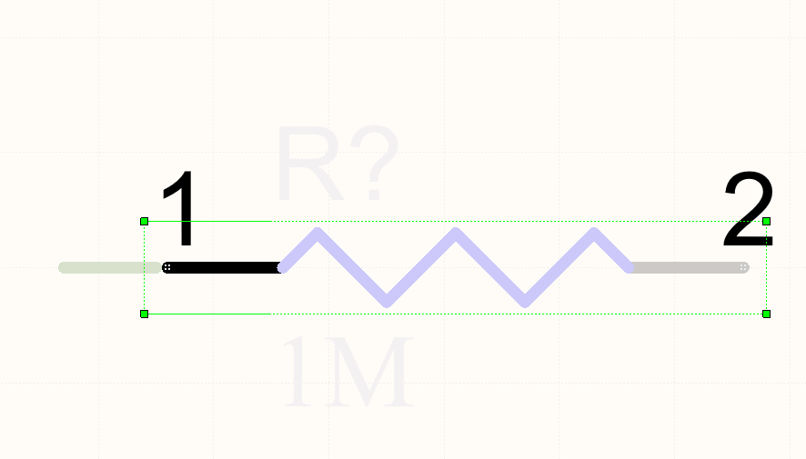

The [schematic shortcut reference](https://www.altium.com/documentation/altium-designer/shortcut-keys/schematic-editors) covers this and the grid shortcuts above. Highlighting helps with a visual check; I still validate the project and review electrical warnings before moving on.
