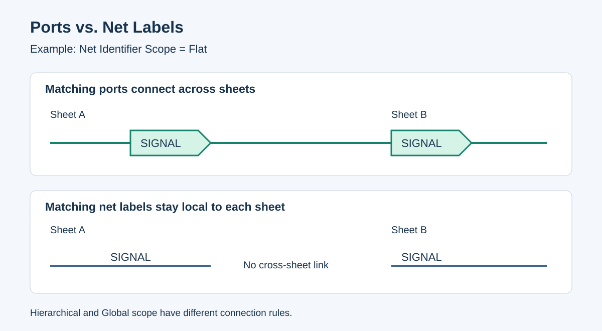

While working on my first schematic project in Altium Designer, I came across a few things that took some figuring out. I’m collecting them here with screenshots, partly as notes for myself and partly in case they’re useful to someone else getting started.

These seven examples come from the **schematic capture** side of the project. I’m still learning, so this is a look at what I’ve been exploring along the way.

## A little context behind the drawing

An isolated sensing circuit is a useful example of why schematic decisions matter. The measurement signal needs to cross an isolation barrier while the sensing and controller sides keep separate electrical references.

Some isolated amplifiers also include isolated power transfer; others need a separate supply on the sensing side. That distinction needs to come from the exact device’s datasheet. On the schematic, I want the supply connections and isolation boundary to be clear to the next person reading it.

The LT1245 symbol below is a separate symbol-editing example, not the isolated amplifier.

## Bringing the design into Altium

I’ll start with how I found component models, then share a few examples of editing symbols, making room on the sheet, and following connections.

### 1. Finding symbols and footprints

There are two ways I’ve used to get component models: Ultra Librarian and Altium’s Manufacturer Part Search. Here’s how each fits into the workflow.

#### Option A: Ultra Librarian

I mostly use **Ultra Librarian** to find the IC’s schematic symbol and PCB footprint, then add them to the library.

From there, I select **Altium Designer** as the CAD platform and download the ZIP file.

#### Option B: Manufacturer Part Search

One thing that confused me at first was the difference between Altium’s online component search and a company’s own library.

**Manufacturer Part Search** helps you find manufacturer and supplier information, along with symbols and footprints where available. An **Altium 365 Workspace** is a separate environment where a team can manage its own components and projects. Finding a part online doesn’t automatically make it part of the company’s approved library.

For me, Manufacturer Part Search has been a convenient alternative to Ultra Librarian. Here’s the route I use to bring an available model into a local library:

1. I search for the part in **Manufacturer Part Search** and look for the models I need.
2. I right-click the part and choose **Download as File Library**.
3. I extract the ZIP file and open the source libraries in Altium.
4. I copy the component into my project library, where I can edit its name or properties.

This saves me a few steps. Before relying on a downloaded symbol, the check is to compare each pin’s name and number with the datasheet. Altium explains the process in its [guide to copying components into libraries](https://www.altium.com/documentation/knowledge-base/altium-designer/copy-and-paste-a-component-from-to-a-library).

### 2. Bringing a symbol into my library

With the models downloaded, I open the `.LibPkg` file in Altium Designer, then its schematic library (`.SchLib`). From there, I copy the component into the library I’m using for the project.

One detail I want to keep track of is pin mapping: each symbol pin number needs to match the intended device pin. If I use a footprint later, its pad mapping will need a separate check too.

Here’s the imported **LT1245** symbol before any changes:

### 3. Rearranging pins for a clearer drawing

One useful trick is to move the pins around the symbol so the connections are easier to follow. For my layout, I grouped them like this:

- **Top:** VCC
- **Bottom:** GND and RT/CT
- **Right:** OUTPUT and ISENSE
- **Left:** COMP, FB, and VREF

The idea is to change where the pins appear on the drawing while **keeping their numbers and electrical identities unchanged**. That lets me tidy up the symbol without changing what each pin represents.

I like keeping pin numbers outside the symbol body and pin names inside. It makes the symbol easier to scan while drawing the circuit.

Here’s the edited version:

The **Properties** panel also has fields for the component’s description, designator, and comment. After editing, a comparison with the datasheet is a useful way to catch accidental changes to pin names or numbers.

### 4. Making a little more room on the sheet

Sometimes I need more room to keep related circuits together. Increasing the sheet size helps avoid squeezing everything into a crowded drawing.

I get to the sheet settings by clicking a blank area so nothing is selected, then opening the **Properties** panel. Double-clicking the sheet border also opens the document options.

The standard sheet sizes are under **Page Options**. A linked template can affect these settings too. See Altium’s [schematic document setup guide](https://www.altium.com/documentation/altium-designer/schematic/setting-up-document) for the available options.

### 5. Getting things lined up with the snap grid

When I started wiring, some pins and connectors didn’t line up neatly. Adjusting the **snap grid** helped me position them more precisely.

The snap grid sets the placement increments for the cursor. The shortcuts I use are **G** to cycle forward through the predefined sizes and **Shift + G** to cycle backward. There’s also a field for entering a value in the document properties.

A **10 mil** grid helped with my alignment work. That was a useful setting for this drawing, rather than a minimum value for Altium. I still want pins and wire endpoints to share a consistent grid so they connect cleanly.

### 6. Getting familiar with ports and net labels

Another task was replacing net labels with **ports** to make signals easier to follow as the project grew across multiple sheets.

The part that helped this make sense to me was the project’s **Net Identifier Scope**:

- **Flat:** matching ports connect across sheets; net labels stay local to each sheet.
- **Hierarchical:** child-sheet ports connect through matching sheet entries on the parent sheet.
- **Global:** matching net labels can also connect across sheets.

So replacing a label with a port is only part of the job. I also need to check the project settings and sheet structure. Altium’s [connectivity guide](https://www.altium.com/documentation/altium-designer/schematic/creating-circuit-connectivity) explains these differences.

I add ports through **Place → Port**. The available I/O types describe the signal direction:

- **Input:** a signal entering the sheet.
- **Output:** a signal leaving the sheet.
- **Bidirectional:** a signal that travels both ways.
- **Unspecified:** no direction specified.

*A simplified example showing how ports and net labels behave with Net Identifier Scope set to Flat.*

These types describe the intended signal direction and support electrical checks. Port cross-references, when configured, also help show where a signal appears on other sheets.

### 7. Taking a closer look at connections

Two wires can look like they touch while still having a small gap. This is an easy detail to miss when zoomed out.

A useful check is **Alt + Click on a wire or another net object**. Altium highlights objects belonging to that net, which helps me follow the connection and spot anything unexpected. If a wire isn’t part of the highlighted net, I zoom in and check its endpoint and grid alignment.

The [schematic shortcut reference](https://www.altium.com/documentation/altium-designer/shortcut-keys/schematic-editors) covers this and the grid shortcuts above. Highlighting helps with a visual check. Project validation and a review of electrical warnings are separate steps to complete before relying on the schematic.

## Where I’m at so far

These are a few snapshots of my schematic work so far. I still have more to explore, including documenting the pin-by-pin datasheet checks and project validation. For now, it’s been helpful to slow down and understand one small part of the drawing at a time.
